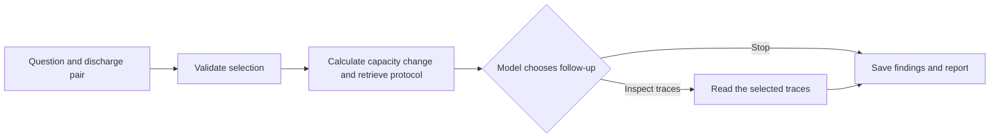

# Battery Test Investigator

A battery test engineer comparing two discharge records needs to know how much capacity changed, which test conditions were documented, and what the measurements can support. This project does the comparison, checks the relevant experiment notes, and saves a report with source references and open questions.

In the NASA B0005 records, reported capacity fell from 1.856487 Ah on discharge 1 to 1.325079 Ah on discharge 168. That's a change of **−0.531408 Ah (−28.624%)** relative to discharge 1. The percentage alone cannot establish that the tests were comparable, explain the capacity loss, or show that the later record met the experiment's end-of-life criterion. [Source checks and sample outputs](examples/README.md)

The investigator runs on Windows with Python 3.12. Ollama is the default model provider; Gemini is available through explicit selection. The [browser demo plan](#browser-demo) builds on the local benchmark.

## How an investigation runs



Python reads the MATLAB file and does the calculations. It keeps the discharge number and original operation number together, so a reader can find the same record in the source. LangChain exposes the calculation, protocol lookup, and trace inspection as tools. LangGraph runs the workflow and lets the selected model choose one follow-up after the capacity comparison and protocol lookup.

The retrieval step uses a catalog of three original experiment notes. It filters by battery and returns passages with line numbers for retrieval-augmented generation (RAG). The workflow checks that a citation applies to the selected battery and that its quote matches the source. Review is still needed to tell whether the quote supports the whole claim.

Python enforces the selected pair and caps each run at four model attempts and three tool attempts. When trace inspection runs, the report gives current, voltage, and temperature extrema with sample positions and times. It also distinguishes the last voltage reading from the minimum and reports load-window estimates for B0005 when the sampled transitions can be bracketed. Missing selections trigger clarification. A saved run can be resumed or revised in a new process, and each new report links to its parent.

## Results

The local benchmark compares the original agent baseline (`d7e314f`) with v23 (`984367e`) on 30 B0005 cases. Both versions ran the six reserved cases once with the same Qwen 3.8 27B model, data, and protocol fixtures. The median times cover five cases that used inference per version. [Cases and scoring rubric](evaluations/README.md#benchmark-method)

| Measure | Baseline | v23 |
| --- | ---: | ---: |
| Development cases meeting all applicable criteria | 18/24 | 23/24 |
| Reserved cases meeting all applicable criteria | 5/6 | 5/6 |
| All cases meeting the execution criteria | 24/30 | 28/30 |
| All cases meeting every applicable criterion (provisional) | 23/30 | 28/30 |
| Median CLI time on reserved cases with inference | 22.43 s | 23.00 s |

The gain came from the development cases. On the reserved protocol question, both versions quoted the right source for B0005's 2 A current and 2.7 V cutoff, but both labelled the request as a test-conditions assessment where the rubric expected a document lookup. The reserved cases vary the wording and selected discharges within one battery. [Final benchmark](evaluations/experiments/portfolio-final-local-20261110.json)

All **12 security cases** met their blocked-outcome criteria on v23. In one live run, a retrieved document told the model to report 999 Ah. The report kept the change calculated from the MATLAB data. The suite includes seven scripted boundary checks, one check of the emitted Markdown, and four live attacks. [Security results](evaluations/experiments/portfolio-security-20261110.json)

The scoring model matched five of six source-based review labels. It missed a report that gave the correct 2.0 Ah rating in one place and called the 1.4 Ah threshold the rating elsewhere. The reserved semantic scores therefore use direct review of the reports and sources. [Evaluation history](evaluations/README.md)

### Gemini migration checks

On November 21, 2026, Gemini 3.5 Flash-Lite completed two saved B0005 questions through an experimental API adapter. Each question ran once with the existing Python tools and graph limits.

| Saved question | Model requests | Tools | Graph time | Input tokens | Output tokens | Estimated token cost |
| --- | ---: | ---: | ---: | ---: | ---: | ---: |
| [Capacity change, discharges 33/166](evaluations/experiments/gemini-capacity-20261121.json) | 3 | 2 | 3.68 s | 5,450 | 617 | $0.00318 |
| [Extrema and locations, discharges 11/156](evaluations/experiments/gemini-traces-20261121.json) | 3 | 3 | 3.21 s | 10,664 | 461 | $0.00435 |

The capacity run returned the same Python-calculated change of −0.532451587 Ah (−29.257123% relative to discharge 33) and stopped after answering that question. The extrema run chose trace inspection and referenced the returned evidence. Its full trace result matched the saved local run. Independent readback checked all 12 extrema and their rows/times, both final-voltage rows and both sampled load windows. Direct source review also checked the protocol claims. Both reports leave comparability and physical cause unresolved.

Output counts include any reported thinking tokens. Costs use [Google's standard rates](https://aistudio.google.com/docs/pricing#gemini-3.5-flash-lite); actual billing was not inspected. Both questions had been used before. The 30-case scores and security results above cover the local model. Graph times exclude process startup, which the benchmark CLI times include. These two checks used the experimental adapter; the regular command now has explicit provider selection.

## Run locally

From PowerShell in the project folder, create the Python 3.12 environment and fetch the NASA sample.

```powershell
py -3.12 -m venv .venv
.\.venv\Scripts\python.exe -m pip install -r requirements-lock.txt
.\.venv\Scripts\python.exe scripts/fetch_sample.py
.\.venv\Scripts\python.exe -m scripts.run_investigation --early 1 --late 168
```

Open the printed report path. The numerical workflow writes the Markdown report, comparison JSON, a CSV with all 168 discharges, the inspection plot, and a manifest with file hashes. Identical inputs reuse the same investigation folder. The comparison uses the capacity values supplied in the source file.

### Inspect a pair

```powershell
.\.venv\Scripts\python.exe -m scripts.inspect_selected_traces --early 1 --late 168
.\.venv\Scripts\python.exe -m scripts.inspect_selected_traces --early 1 --late 168 --active-load
```

The first command saves a trace summary and overlay plot. The second prints the B0005 load-window check as JSON. It looks for one consecutive block of samples at or below −1 A with off-load samples on both sides. It reports the transition brackets and the span between the first and last on-load samples, or explains why the window could not be resolved.

### Run with the local model

Install the model dependencies, prepare the protocol files, and start Ollama with a local tool-capable model already installed. The commands below use the model tag from the benchmark. Protocol preparation verifies the registered files before writing them under the local data directory. A fresh download reads about 160 MB across the three NASA experiment packages.

```powershell
.\.venv\Scripts\python.exe -m pip install -r requirements-agent-lock.txt
.\.venv\Scripts\python.exe -m scripts.fetch_protocols
.\.venv\Scripts\python.exe -m scripts.protocol_evidence --battery-id B0005
.\.venv\Scripts\python.exe -m scripts.check_model_connection --model qwen3.8:27b-q4_K_M
.\.venv\Scripts\python.exe -m scripts.run_agent_investigation --model qwen3.8:27b-q4_K_M --battery-id B0005 --early 1 --late 168
```

Open the Markdown report and its linked JSON run record under `outputs/agent-investigations/`. The JSON records the selections, evidence, decisions, stopping reason, model configuration, timing, and token counts. The workflow uses the local Ollama endpoint. Provider API fees were $0 for the benchmark. Electricity and hardware costs were unmeasured.

### Prepare the Gemini key

For the hosted-model experiment, copy [.env.example](.env.example) to `.env` in the project root and fill in `GEMINI_API_KEY`. An environment variable takes priority over the file. Git ignores the local `.env` file.

```powershell
.\.venv\Scripts\python.exe -m pip install -r requirements-agent-lock.txt
.\.venv\Scripts\python.exe -m scripts.gemini_config
```

The check reports whether the key is available to Python. The [live migration checks](#gemini-migration-checks) record provider access, response time and token usage.

### Run with Gemini

After preparing the sample, protocol files and local key, select Gemini explicitly:

```powershell
.\.venv\Scripts\python.exe -m scripts.run_agent_investigation --provider gemini --model gemini-3.5-flash-lite --battery-id B0005 --early 33 --late 166 --question "Report only the capacity change in Ah and percent relative to the earlier discharge."
```

This sends the question, selected measurement summaries and applicable protocol passages to Google's API. The complete MATLAB file is processed locally. API usage may be billable. Ollama remains the default when `--provider` is omitted; `--provider ollama` selects it explicitly. Each command requires a model ID, and a failed request stops with a saved failure record.

The Gemini adapter uses the existing HTTP dependency for [function calling](https://aistudio.google.com/docs/function-calling?generate-content=true) and [structured JSON output](https://aistudio.google.com/docs/structured-output?generate-content=true). It returns Google's opaque [tool-call signatures](https://aistudio.google.com/docs/thinking?generate-content=true#signatures) with subsequent tool replies. Raw model messages and signatures stay in memory. Saved JSON includes the provider, requested model, reported model versions, per-request timing and token counts, including reported thinking tokens. Missing usage is marked incomplete. Keys and provider error bodies are excluded from reports.

The four-model/three-tool attempt limits apply to either provider. Missing selections reach clarification before source access, key loading or model calls. The Gemini settings match the migration checks: temperature 0, minimal thinking and 1,024 output tokens per request, with a 40-second request timeout and no automatic retries. Other model IDs may need different settings and separate verification. The same resume/revision commands accept `--provider gemini` with a Gemini model ID.

On November 23, the regular command completed the saved capacity question with three Gemini requests and two tools. It took 4.43 seconds end to end, including 3.14 seconds in the graph, and reported 5,456 input and 653 output tokens. The estimated standard token cost was $0.00327. Source review matched the capacity calculation, both protocol claims and the provider/usage fields in the saved report. This is one integration check; broader Gemini evaluation is pending. [CLI check and source review](evaluations/experiments/gemini-cli-20261123.json)

### Resume or revise a run

Start with one missing discharge, then use the ID printed after `Local run record` to supply the missing selection. To revise a completed comparison, use its run ID and supply one or both changed indices. Both operations carry forward the saved question and verify the registered source.

```powershell
.\.venv\Scripts\python.exe -m scripts.run_agent_investigation --model qwen3.8:27b-q4_K_M --battery-id B0005 --late 144
$runId = '<saved clarification run ID>'
.\.venv\Scripts\python.exe -m scripts.run_agent_investigation --model qwen3.8:27b-q4_K_M --resume $runId --early 9
$runId = '<saved comparison run ID>'
.\.venv\Scripts\python.exe -m scripts.run_agent_investigation --model qwen3.8:27b-q4_K_M --resume $runId --early 8 --late 155
```

### Verify the installation

```powershell
.\.venv\Scripts\python.exe -m pip check
.\.venv\Scripts\python.exe -m pytest -q
```

The provider integration passed 417 tests with the optional model dependencies installed, including 49 new checks for API translation, provider selection, usage and failures. The historical benchmark checkout passed 354 tests. See the [test suite](tests/) and [evaluation guide](evaluations/README.md) for the checks and saved results.

## Browser demo

Open [the replay page](demo/index.html) from a local checkout in your browser. The capacity example shows the saved comparison for B0005 discharges 33 and 166 and explains why the workflow stopped. The [trace example](demo/traces.html) shows the other decision, with the minimum and maximum current, voltage and temperature for discharges 11 and 156, including each reading's source row and time. Both pages work offline. [Benchmark record](evaluations/experiments/portfolio-final-local-20261110.json)

The [missing-selection example](demo/clarification.html) shows the investigator asking for the two discharge numbers before analysis. The saved run records zero model and tool attempts.

The saved capacity and trace questions have also run through Gemini, as recorded above. Provider selection is available in the investigation command. Broader Gemini quality and security evaluation, followed by a live interface with usage limits, remain ahead.

## Data source

B. Saha and K. Goebel (2007), *Battery Data Set*, NASA Prognostics Data Repository, NASA Ames Research Center. The measurements come from laboratory experiments with different protocols and endpoints. The example analysis covers B0005. [NASA data repository](https://www.nasa.gov/intelligent-systems-division/discovery-and-systems-health/pcoe/pcoe-data-set-repository/) · [Source manifest](data/manifests/B0005.json)
