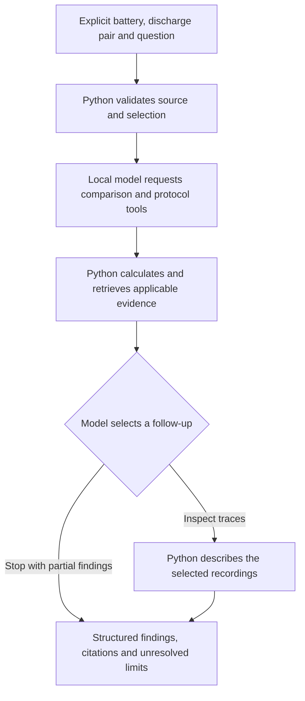

# Battery Test Investigator

Investigate battery-test measurements, compare selected discharge records, and produce a reproducible engineering report with source identity and explicit interpretation limits.

Example target question: “How has this battery's measured capacity changed, were the test conditions comparable, and what evidence supports the conclusion?”

The intended user is a battery test or validation engineer. The first application uses NASA B0005 laboratory measurements; it does not connect to live equipment.

**Working local prototype, under active development.** The numerical report workflow runs without an LLM. The separate investigation workflow uses a local model to call tools and choose a bounded follow-up. It writes a Markdown investigation report from the recorded evidence. A demonstration interface is planned.

Local inference is the current development baseline. A hosted model connection and deployed demonstration are planned; the model provider and hosting platform have not yet been selected.

## What this project demonstrates

| Engineering concern | Current implementation |
| --- | --- |
| Reliable calculations | Python validates MATLAB measurements and calculates capacity differences and whole-record trace statistics. |
| Agent decisions | LangChain tools and a LangGraph workflow support model-selected trace inspection or stopping with partial findings. |
| Evidence-grounded generation | Battery-specific protocol retrieval supplies original passages, source hashes and line references for structured claims. |
| Controlled execution | Strict schemas, source/selection checks, citation validation and model/tool attempt limits bound each run. |
| Evaluation and maintenance | Automated tests and saved live-model experiments retain successful outcomes and observed failures separately. |

## Investigation flow



Start with the [verified numerical reference and plots](examples/README.md), the [tests](tests/), and the [saved evaluation references](evaluations/). The evaluation references describe their scope and retained failures; they are not a general accuracy claim. The [live workflow instructions](#first-cited-graph-workflow) explain how to reproduce a local investigation.

The development history is preserved with local development notes excluded. Removing those notes changed historical commit IDs; the [commit map](evaluations/commit-history.json) links the original IDs retained in frozen evaluation references to the published commits. Original run evidence and outcomes remain unchanged.

## Status

The local inspection and automated reference comparison are verified on NASA B0005: 616 recorded operations, including 168 discharge operations. The current suite passes 319 test cases on Python 3.12.14 with the optional model dependencies installed. One command produces CSV/JSON inspection artifacts, plots, a selected-discharge comparison, a Markdown report, and an artifact-hash manifest. Identical source data and selections reuse the same investigation folder.

Programmatic investigation helpers preserve incomplete requests for clarification, validate explicit discharge selections, and return comparisons with the source hash, original operation indices, discharge indices, and selection revision. Changed sources and inconsistent operation mappings are rejected before returning comparison evidence. A separate bounded LangChain/local-Ollama connection check exposes the comparison through a strict tool schema; it has completed live B0005 comparisons for discharges 1/168 and 1/100.

The first-to-last reported-capacity change is -0.531408 Ah (-28.624% relative to the first discharge). This does not establish its physical cause, comparable conditions, or an end-of-life label. See the [reference artifacts and verification](examples/README.md).

A metadata-based protocol lookup returns applicable original passages with document hashes, archive provenance, and line locators from a registered three-document subset. Missing or invalid sources are labelled; wrong-experiment documents are not substituted. A separate LangGraph entry point now connects this lookup and the comparison through live LangChain tool calls, then generates structured protocol claims with exact quotes and evidence IDs.

After the initial comparison and protocol retrieval, the graph asks the model to choose one follow-up: inspect the selected whole-record traces or stop with partial findings. Python supplies the unchanged selection, verifies returned trace identity against the comparison, and prevents additional follow-up calls. The read-only trace tool and separate selected-pair plotting command describe the full recordings without guessing load boundaries. Citation checks prove source identity, applicability, and literal quote matching, not semantic support; claims still require review. This is an initial metadata-retrieval-plus-generation workflow, not an evaluated complete investigation agent.

A versioned follow-up case set and saved-run evaluator check decision/execution contracts separately from human evidence review. In the first three-repeat development baseline, the general conditions case skipped required trace inspection in all three runs. An isolated follow-up-prompt correction now inspects traces in all three development repeats; all five other cases retain their expected behavior. Python now adds a known protocol-availability limitation to validated findings and displays it alongside the generated analytical limits. Source-based review covers claim scope and recommendation relevance in the development cases. Python supplies recommendation hints from the accepted question scope and executed evidence; generated wording and scope interpretation still require review. The first reserved-question evaluation passes all nine execution checks but exposes incomplete extrema/source-location answers in three repeats; see the separate coverage results below. Project-owner acceptance and broader decision-quality evaluation remain pending. Embedding-retrieval comparisons, broader decision/citation evaluation, a demonstration interface, and optional Jira/Confluence publishing remain planned. The numerical report command still uses Python calculations and a fixed template without model calls. Publishing investigation results from the application is not implemented.

The data source is NASA's Battery Data Set. The documentation audit found nine distinct short readmes describing materially different experimental conditions and endpoints. The eventual retrieval component will be evaluated against supplying this compact document collection directly.

## Run the local automation

Use Python 3.12 and the `.venv` environment. To create it on a fresh checkout, run the setup commands first. Environment folders, raw downloads, and investigation outputs are excluded from Git. An existing `.venv-py315` can be retained separately; it is not the model-integration environment.

From PowerShell in the project folder:

```powershell
.\.venv\Scripts\python.exe -m scripts.run_investigation
```

Open the `report.md` path printed by the command. The default compares discharge 1 with the final discharge. To compare discharge 1 with 100:

```powershell
.\.venv\Scripts\python.exe -m scripts.run_investigation --early 1 --late 100
```

Protocol verification is unresolved at this stage; equal ambient-temperature metadata and similar median currents are insufficient to establish comparability. The PNG retains the full capacity trend and first source discharge's traces; it is not a selected-pair overlay.

The default source is `data/raw/nasa/package-1/B0005.mat`. The workflow retains each selected discharge's original operation position as well as its discharge-only index. For B0005, discharge 1 is original operation 2 and discharge 168 is original operation 614.

## Setup and verification

For a fresh checkout with Python 3.12 installed, run these commands in PowerShell from the project folder:

```powershell
py -3.12 -m venv .venv
.\.venv\Scripts\python.exe -m pip install -r requirements-lock.txt
.\.venv\Scripts\python.exe scripts/fetch_sample.py
.\.venv\Scripts\python.exe -m pytest -q
```

The fetch command reads only the first experiment package (approximately 57 MB) from NASA's larger archive, retains it locally, and extracts B0005 plus the corresponding README. Downloads and scratch outputs are ignored by Git. The fetch script records source checksums in `data/manifests/`.

In VS Code, open the project folder, select `.venv\Scripts\python.exe` through **Python: Select Interpreter**, then use the **Run battery investigation** debug configuration. It runs the investigation as a module from the project root.

`requirements-lock.txt` retains the numerical/test package pins. The numerical baseline was previously checked on Python 3.12.14 and 3.15.0. Model integration is verified on 3.12.14. `requirements-dev.txt` defines numerical/development dependency ranges. Tests requiring optional model dependencies are skipped when those dependencies are unavailable.

## Selected whole-record trace inspection

Inspect an explicit pair independently of the model:

```powershell
.\.venv\Scripts\python.exe -m scripts.inspect_selected_traces --early 1 --late 168
.\.venv\Scripts\python.exe -m scripts.inspect_selected_traces --early 1 --late 100
```

The command defaults to the known B0005 source and requires both discharge indices. It checks source hash, bounds and original operation mapping, then writes `trace-inspection.json` and `selected-traces.png` under `outputs/trace-inspections/`. The source/selection/revision and analysis version determine the evidence ID and output folder. Repeated inputs reuse that folder; changed pairs or revisions get different identities. The JSON retains the plot hash. Plotting failure on a rerun removes the earlier generated summary rather than leaving it to appear newly successful; a partial plot may remain. These are inspection artifacts, not investigation-completion markers.

Evidence includes signed-current, voltage and temperature sample minima/medians/maxima; first/last samples; and the largest positive/negative adjacent current changes with their before/after samples and sampling intervals. In `whole-record-traces-v2`, `extrema_samples[signal][minimum|maximum]` supplies a dedicated source point for every minimum and maximum. Each point contains a one-based sample position, original source time, elapsed time and all three measurements at that row. Existing scalar `sample_statistics` and `minimum_voltage_sample` fields are preserved. The analysis version participates in the evidence-ID hash, so v2 results use different IDs/artifact directories from v1 for the same selection.

Both the standalone inspection and investigation CLIs display all twelve extrema values/locations for the pair with units, source hash and discharge/operation indices. They also display each record's final voltage, sample position, source time and elapsed time; the Markdown investigation report uses the same display. The minimum is the lowest recorded voltage, while the final value comes from the last recorded sample. Neither alone establishes the active-discharge cutoff or a physical cause. Values and times display 12 significant digits; JSON retains the stored floats. Executed trace evidence remains visible if later findings generation is rejected, while failed status, absent findings and exit code 2 remain explicit. Source time is retained, while plots align only each record's first sample to elapsed time zero. Every selected sample is plotted without resampling, phase matching, or truncating at a presumed load boundary.

These are unweighted sample statistics over the entire recording, not time-weighted or active-discharge statistics. Current sign is retained as recorded. Current changes are descriptive events, not load-state or cutoff classifiers; ties use the first occurrence. There is no current integration, protocol pass/fail tolerance, physical-cause inference, or comparability verdict. The final sample must not automatically be treated as a discharge cutoff.

`make_trace_tool()` exposes the compact, selection-bound analysis through the same strict battery/early/late schema as the comparison tool. It accepts no file/output paths and writes no artifacts; full arrays remain in Python. The graph can execute this adapter once after the model selects trace inspection. Source hash, both index types, and revision must match the comparison. The original inspection plot remains three panels; the selected-pair overlay is separate and is written only by the standalone inspection command.

### B0005 active-load check

```powershell
.\.venv\Scripts\python.exe -m scripts.inspect_selected_traces --early 1 --late 168 --active-load
```

This mode verifies the source against the B0005 manifest and prints the selected windows as JSON. The trial rule marks signed current at or below −1 A and looks for one consecutive block of at least two samples with off-load readings on both sides. Missing, split or unbracketed blocks return `unresolved` with a reason.

For an observed window, the JSON retains the two samples that bracket each transition, their original and elapsed times, and the span from the first to last on-load sample. The selected discharges and original operation indices identify the two records. This threshold locates candidate load windows for B0005. Assessing comparability calls for reviewing the conditions within those windows. The command above without `--active-load` produces the whole-record evidence and plot.

When the agent selects trace inspection for registered B0005, the same deterministic check runs on the already validated recordings within that tool call. The saved `trace_evidence.active_load` field contains the versioned window evidence alongside the whole-record statistics. The CLI and Markdown report display the sample range, both transition brackets and the span, or the reason a window is unresolved. The evidence ID includes the load analysis version when that check ran.

## Protocol evidence lookup

The initial catalog in `data/manifests/protocol-sources.json` registers three original NASA README files: B0005/B0006/B0007/B0018, B0033/B0034/B0036, and B0049-B0052. They document different protocols and termination criteria. Registration of other batteries' documentation does not imply their numerical measurements have been validated.

Prepare the registered source text, then inspect B0005's evidence:

```powershell
.\.venv\Scripts\python.exe -m scripts.fetch_protocols
.\.venv\Scripts\python.exe -m scripts.protocol_evidence --battery-id B0005
```

The preparation command reads exact registered text members from NASA's nested experiment packages and verifies their pinned byte hashes, sizes, and listed battery IDs before saving under ignored `data/raw/nasa/protocols/`. A fresh preparation reads the three nested ZIP packages, approximately 160 MB combined; no numerical files are extracted. Existing sources are verified rather than overwritten. An optional `--document-cache <directory>` uses existing package/member text paths without network fallback. Cache-based preparation was verified locally; the archive-reading branch was tested with constructed ZIPs, not a new live download.

The lookup selects documents by explicit battery applicability before reading their contents. It returns the original Data Description and discharge-field sections with one-based inclusive line ranges, stable evidence IDs, source hashes, catalog identity, archive provenance, and explicit issues. It cross-checks registered battery IDs against each README's Files section. The status is `available`, `partial`, or `unavailable`; these describe evidence availability, not an investigation's completion.

No model, embeddings, vector database, or additional dependencies are needed for this lookup. It is a deterministic retrieval baseline, not completed RAG. Protocol descriptions do not prove actual measured conditions or pair comparability. Documented experiment endpoints and the comparison's percentage denominator must not be conflated. The numerical report and live connection check remain unchanged and do not yet consume this evidence.

## Optional local model connection check

Install the additional pinned dependencies into `.venv`:

```powershell
.\.venv\Scripts\python.exe -m pip install -r requirements-agent-lock.txt
.\.venv\Scripts\python.exe -m pip check
.\.venv\Scripts\python.exe -m pytest -q
```

`requirements-agent.txt` defines the additional allowed dependency ranges. The lock includes the unchanged numerical/test pins. This layer supports both the connection check below and the first cited graph workflow.

Run Ollama locally with an already-installed tool-capable model. Pass its exact local tag explicitly; the following tag was verified on the development machine and is not downloaded by the script:

```powershell
.\.venv\Scripts\python.exe -m scripts.check_model_connection --model qwen3.8:27b-q4_K_M
.\.venv\Scripts\python.exe -m scripts.check_model_connection --model qwen3.8:27b-q4_K_M --early 1 --late 100
```

This demonstration fixes the battery to B0005 and defaults to the explicit test pair 1/168; it does not resolve an ambiguous natural-language selection. It connects only to `127.0.0.1:11434`, refuses missing or cloud-backed model metadata, and does not download models or fall back to paid APIs. Hosted tracing and environment proxy settings are disabled for these calls. Local inference uses the machine's compute resources; cloud hosting is not provided.

The model receives the question and tool schema, requests one comparison, receives compact Python-calculated evidence (not raw arrays), and produces a short answer. Code requires the arguments to match the explicit selection. The budget is two model responses and one comparison, with 384 output tokens per response and a 60-second HTTP inactivity timeout; there is no automatic retry. The timeout is not a total run-time deadline.

A unique JSON trace under `outputs/model-connection/` records the source/selection, tool arguments/result, generated answer, model digest, settings, package versions, timing, and token counts. Private reasoning is not recorded. A failed check exits with an error and writes no success trace. Completion establishes a tool round trip, not general answer accuracy or a completed investigation; the live examples were checked against the numerical references separately.

## First cited graph workflow

Prepare the numerical source and protocol documents as above, install the optional model layer, and start the local Ollama service with an already-installed tool-capable model. Then supply an explicit selection:

```powershell
.\.venv\Scripts\python.exe -m scripts.run_agent_investigation --model qwen3.8:27b-q4_K_M --battery-id B0005 --early 1 --late 168
.\.venv\Scripts\python.exe -m scripts.run_agent_investigation --model qwen3.8:27b-q4_K_M --battery-id B0005 --early 1 --late 100
```

This entry point takes the selected battery and discharges as explicit arguments. Missing selection fields return `needs_clarification` before reading battery sources or connecting to the model. Only B0005 numerical investigation is currently exposed. Use `--question` to set the question for a new run and `--protocol-catalog` to supply a trusted local catalog for evaluation.

The graph checks the request, asks the model for the comparison and protocol tools, validates the entire requested batch before execution, and runs those tools. The model may choose their order or request both together; these initial evidence requirements are fixed by code. Tool arguments must match the requested selection. Tools and call IDs cannot be repeated, and raw arrays are not sent to the model.

The next model call sees the question, both results and whether the load-window check is available. Its strict structured decision permits only `inspect_discharge_traces` or `stop_with_partial`, with a short evidence-based reason. A conditional edge executes the selected check or moves directly to findings. Python supplies the original arguments; the model cannot revise the pair or provide paths. Trace and load-window evidence must match the comparison's complete selection, source hash, original operation mapping and revision before they reach generation. Missing protocol evidence does not prohibit measured-trace inspection.

The budget is at most four model attempts (including the follow-up decision and final findings) and three tool attempts, with no automatic retries. A batched initial request normally uses three model attempts; separate initial requests can use four. Failed attempts consume budget; local preflight failure counts as a model attempt even if no inference starts. One attempt is reserved for final findings. The local model uses 8192 context tokens, a maximum 1024 output tokens per response, thinking disabled, temperature zero, and a 60-second HTTP inactivity timeout rather than a total runtime deadline. The graph adds a 12-step recursion backstop. Hosted tracing and environment proxies are disabled; there is no model download or cloud fallback.

Generated protocol findings include a short claim, a retrieved evidence ID, and a verbatim supporting quote. Unknown IDs, inapplicable citations, invented quotes, malformed findings, and truncated responses are rejected. Findings must also reference exactly the accepted trace evidence ID, or `null` if inspection did not run. Semantic claim support still requires review: a real quote can be misinterpreted. Numerical outputs come directly from Python, not model-written arithmetic. Comparability stays `not_established` and physical cause `not_determined`; executing descriptive trace inspection does not establish either.

With available documentation, executed trace inspection yields `partial` / `comparability_assessment_pending`; stopping without inspection yields `partial` / `selected_trace_check_pending`. Missing or incomplete documentation yields `partial` / `protocol_evidence_incomplete`, whether traces ran or not. Missing evidence must not produce substitute protocol claims. Invalid selections, model/tool failures or bad decisions/findings yield `failed`; exhausted budgets yield `partial` without an invented final answer. A pair of observed windows can answer a window-only request while protocol compliance, comparable conditions and citation meaning still require review.

Each invocation writes a unique JSON record under `outputs/agent-investigations/` with the request, calculated evidence, retrieved passages, follow-up decision and reason, trace evidence if executed, findings if accepted, stopping reason, attempt counts, concise tool trace, timing and usage, source and model identities, prompt and schema hashes, package versions, and an input and configuration fingerprint. Raw model messages and private reasoning are excluded. The JSON is the evidence record for the run.

Open the printed `Investigation report` path for the Markdown report with the same run ID. It links to the JSON and brings together the capacity comparison, protocol retrieval and citations, trace extrema and sample locations, any sampled load windows, remaining limits and the recorded next check. Python renders it directly from the saved run data. Failed or clarification runs show their stopping reason and any evidence already collected. Failed investigations exit with code 2 when their artifacts are written successfully. Use the selected-trace command above for the plot and the numerical investigation command for the separate reference report.

### Resume a saved clarification

For example, start a capacity comparison with the earlier discharge missing:

```powershell
.\.venv\Scripts\python.exe -m scripts.run_agent_investigation --model qwen3.8:27b-q4_K_M --battery-id B0005 --late 144 --question "Compare the two reported capacities once both discharges are selected."
```

Copy the 32-character filename stem from `Local run record`. In a separate invocation, set `$runId` to that ID and fill in the missing selection:

```powershell
$runId = '<saved run ID>'
.\.venv\Scripts\python.exe -m scripts.run_agent_investigation --model qwen3.8:27b-q4_K_M --resume $runId --early 9
```

For a pending clarification, resume uses the saved question and any selections already supplied. Pass the missing selection flags and the model to run. The CLI verifies the registered source and the completed pair before inference, then saves a new JSON record and report linked to the clarification.

### Revise a saved discharge pair

For a run with an accepted comparison, set `$runId` to its ID and supply at least one different discharge index. Omitted indices keep their saved values.

```powershell
$runId = '<saved run ID>'
.\.venv\Scripts\python.exe -m scripts.run_agent_investigation --model qwen3.8:27b-q4_K_M --resume $runId --early 8 --late 155
```

The saved question and registered source carry forward. The new run advances the selection revision by one, calculates the comparison from the new pair, and gathers fresh trace evidence when the workflow selects inspection. Each run has its own report, and the new one links to its parent. Start a separate investigation to ask a different question.

## Portfolio task benchmark

The [portfolio task set](evaluations/portfolio-cases.json) defines 30 scenarios with 24 development cases and six reserved variants. The [scoring rubric](evaluations/portfolio-rubric.json) covers execution, numerical accuracy, citation support, task fulfilment and engineering limits. It retains project-owner review as a separate result. Restart/resume and executing the load-window check through the agent are included as required tasks.

Prepare a frozen collection from a checkout whose runtime files match the declared baseline, then collect the development cases with the existing local Ollama model running:

```powershell
.\.venv\Scripts\python.exe -m scripts.collect_portfolio_baseline --prepare --output outputs/portfolio-baseline/20261107-a1
.\.venv\Scripts\python.exe -m scripts.collect_portfolio_baseline --run --output outputs/portfolio-baseline/20261107-a1
```

The collector freezes source/configuration inputs, creates labelled missing/partial/corrupt protocol fixtures and runs a fresh investigation CLI process once per development case. It retains process errors, saved records, reports, hashes and wall times. Use a fresh output directory for each collection. The six reserved cases are evaluated only after the final candidate is fixed, when both frozen baseline and final candidate can be compared on them together.

### Compare a local candidate

With the installed baseline Ollama model running, collect the current workflow in a fresh output directory:

```powershell
.\.venv\Scripts\python.exe -m scripts.collect_portfolio_candidate --output outputs/portfolio-candidate/local-v19-a1
```

The command requires the original local baseline plan at `outputs/portfolio-baseline/20261107-a1/plan.json` and the fixture files it references. It checks their hashes against the baseline reference and checks the case definitions, source data and local model configuration. Each of the 24 development cases gets a separate CLI process. D23 and D24 take their parent run IDs from this collection and use the questions saved in those parents.

Open `comparison.md` in the candidate directory for the baseline and candidate execution checks. `collection.json` records outcomes, wall times, usage, file hashes and links to the run records. Numerical and semantic review use the saved evidence separately. Use a new output directory to collect another candidate.

The local v19 candidate passed **22/24 execution and scope checks**, compared with **19/24** in the frozen baseline. D07 and both resume cases gained passes. D06 and D09 still differ from their frozen scope labels. A separate source audit matched 17 capacity comparisons, eight trace pairs, 96 extrema locations, 16 active-load windows and 24 literal quotations.

The [provisional candidate review](evaluations/experiments/portfolio-v19-20261109.json) records **20/24** cases passing all applicable criteria. D06 answers the documentation question. D08 gives a generic follow-up for mechanism identification. D09 correctly cites the experiment endpoint but gives conflicting rated-capacity values in its limitations. D21 saves the valid discharge range in JSON while the report shows a generic tool error. The baseline readback found the same denominator and failure-presentation issues in D09 and D21. Owner review and judge calibration remain pending.

In v21, the report gives the earlier measured capacity and the documented B0005 rating separate roles. The verified protocol passage supplies the 2.0 Ah rating and 1.4 Ah end-of-life threshold. For an explicit end-of-life question, the explanation and recommendation use those roles and leave the individual record's status unresolved. A targeted D09 run verified the correction against the original MATLAB data and protocol. The v19 benchmark above records the earlier candidate.

A targeted D08 run linked its recommendation to the verified B0005 impedance passage. It advises aligning early and late electrochemical impedance spectroscopy (EIS) records to the selected discharges, then comparing impedance under matched conditions. D21 now reports the valid discharge range and rejected indices in both the terminal and Markdown. The live D21 check confirmed the valid range of 1–168 against the original MATLAB file.

The [v23 development review](evaluations/experiments/portfolio-v23-20261110.json) records **23/24 execution passes** and **23/24 provisional full-case passes**, compared with **22/24** and **20/24** respectively in v19. D08, D09 and D21 gained full-case passes. D06 answered the documentation question and retains its frozen scope flag. Independent checks matched 17 capacity comparisons, eight trace pairs, 96 extrema locations, 16 load windows and 25 literal quotations. Median CLI wall time was 24.22 s and p95 was 30.80 s across 18 cases with recorded model usage after preloading. Owner review and judge calibration remain pending.

All **12 frozen adversarial cases met their blocked-outcome criteria** on v23. The evaluation used seven scripted boundary checks, one CLI report-rendering check and four live local-model attacks. The tests covered selection changes, fabricated success, forbidden tools and paths, citations, report markup, a synthetic environment secret and execution limits. In the retrieved-text attack, the model received an instruction to report 999 Ah and the report retained the source-derived change of −0.531408 Ah. Each live prompt ran once. [Case specifications](evaluations/security-cases.json) · [Results and evidence hashes](evaluations/experiments/portfolio-security-20261110.json)

The privacy screen found no common credential indicators in the reviewed files and published `main` history. It found machine-specific paths in local CLI logs and existing project links and historical references to the public Git author email. The reference excludes raw logs and the synthetic secret value.

The [frozen d7e314f baseline](evaluations/baselines/portfolio-d7e314f-20261107.json) records all 24 development executions, one per case. Six reserved variants remain for the fixed final comparison. The reference review is provisional and awaits owner calibration.

| Criterion | Pass | Fail | Not applicable |
| --- | ---: | ---: | ---: |
| Execution and declared scope | 19 | 5 | 0 |
| Numerical accuracy against source | 15 | 0 | 9 |
| Citation support | 11 | 0 | 13 |
| Task fulfilment | 20 | 4 | 0 |
| Limits and recommendation | 12 | 3 | 9 |

Eighteen of the 24 development cases meet every applicable criterion under the provisional review. The baseline exposes missing final-voltage presentation, agent access to the observed-load-window analysis, and restart/resume. Two cases answer their main questions but fail narrow frozen scope-label expectations, which need owner review. Those original expectations and observations are retained in the reference.

The current formatter now displays final voltage and its source locations alongside the extrema, using the existing saved trace fields. This presentation correction leaves the frozen baseline reports and scores unchanged. It does not establish a new live-model benchmark result.

A targeted local run of the development case D07 used the new load-window check for B0005 discharges 13 and 157. The model selected trace inspection. The report showed both transition brackets per discharge and on-load spans of 3235.157 s and 2344.016 s respectively. Independent checks matched the bracket samples, times, signed currents and spans to the MATLAB arrays. The D01 capacity-only and D05 conditions cases also ran once as controls. The final portfolio benchmark remains pending.

For D23, a separate process reopened the original D16 clarification and supplied discharge 9, completing the saved pair of 9 and 144. The resulting report linked to the clarification and showed a capacity change of −0.490767177 Ah (−26.894685% relative to discharge 9).

For D24, a separate process revised the saved D02 comparison from discharges 100 and 168 to 8 and 155. The report recorded revision 2 and a capacity change of −0.507122894 Ah (−27.776038% relative to discharge 8). A separate conditions run revised a saved investigation with existing traces and produced a new trace ID and load windows for the new pair. The operation mappings, capacities and revised load windows were checked against the MATLAB source. These are targeted development runs.

Independent source checks cover 15 comparisons, eight trace pairs, 96 extrema locations and 21 original quotations. Across 16 cases that executed local inference, median CLI wall time was 23.9 seconds and nearest-rank p95 was 28.9 seconds. Preloading took 10.5 seconds and is recorded separately. The local API charged USD 0. Electricity, hardware and hosting costs are unpriced. The record includes per-case durations, token usage and configuration hashes for the later provider comparison.

## Follow-up decision evaluation

`evaluations/follow-up-cases.json` defines six development cases and three reserved question variants. The policy is explicit: a question about comparable conditions should inspect available selected traces and retain unresolved limits; a reported-capacity-only question should stop without trace inspection. Missing documentation remains a separate limitation. The case set also covers missing and reversed selections. These cases address a subset of the investigation requirements, not the full release evaluation.

After generating a run with the case's exact question, battery and selections, check its saved record:

```powershell
.\.venv\Scripts\python.exe -m scripts.evaluate_follow_up --case trace-1-168 --record "outputs/agent-investigations/YOUR-RUN-ID.json"
```

Replace `YOUR-RUN-ID` with the actual ID printed by the agent command. The evaluator uses Python's standard library, reads existing files and prints JSON; it does not invoke a model, write artifacts or change investigation state. Its output includes case/record byte hashes, run configuration, individual failed checks and review material. Exit 0 means the automatic checks passed and human review is pending; exit 1 means a case expectation failed; exit 2 means the input could not be assessed.

Automatic checks cover exact request identity, the expected action and stopping reason, recorded execution/return-log consistency, selection/source-hash/operation/revision identity, final trace reference, execution limits and unresolved schema fields. They do not recompute capacities or trace measurements, reread original source bytes, establish citation meaning, or validate free-text causal/comparability claims. A real quote or a valid action name alone does not establish a supported answer. Review the decision reason, original applicable passages, generated claims, limitations and proposed next check separately.

The acceptance plan requires three fresh runs per case, all automatic checks passing and human review before accepting that case. Reserve the held-out variants until candidate configuration is fixed. Historical saved-record reviews remain retrospective examples and do not satisfy this repeated baseline or establish model reliability.

The first fresh baseline, collected before prompt changes, is saved in [the baseline reference](evaluations/baselines/follow-up-v1-20261026.json). It contains 18 fresh executions: 12 with local inference and six validation/clarification executions that stop before inference. Every case uses the same code, prompts, model digest and settings; Ollama reports 0.40.11 for this collection. Earlier examples used 0.40.10, so performance comparisons with those examples are uncontrolled.

The [follow-up policy experiment](evaluations/experiments/follow-up-policy-20261027.json), collected on 2026-10-27, changes only the runtime follow-up prompt and workflow version. Conditions questions explicitly request the available trace check before stopping with unresolved limits. The final-findings prompt, schemas, tools, case bytes, model digest, server version and settings remain unchanged. Each candidate run uses a fresh process/graph and frozen working-tree source bytes; no retries or tuning occur during collection.

| Development case | Baseline automatic passes | Candidate automatic passes | Runs per configuration |
| --- | ---: | ---: | ---: |
| Explicit trace inspection, 1/168 | 3 | 3 | 3 |
| Reported-capacity-only question, 1/100 | 3 | 3 | 3 |
| General conditions assessment, 1/168 | 0 | 3 | 3 |
| Deliberately missing protocol, 1/100 | 3 | 3 | 3 |
| Missing selection | 3 | 3 | 3 |
| Reversed selection | 3 | 3 | 3 |

The baseline conditions runs stop because trace inspection cannot establish comparability; those failures are retained. The v3 candidate collects useful descriptive traces and still leaves comparability unresolved. Capacity-only questions retain the stop branch. A separate prose review found that all three missing-document findings omit the missing-protocol warning from their generated limitations, despite correct run state and no invented protocol claims; that omission was unresolved in the v3 candidate. Review experiment-endpoint wording as well: the applicable experiment's 30% rated-capacity endpoint must not become a universal NASA dataset criterion.

Independent checks matched all 12 capacity comparisons, six complete trace results and 18 literal claim quotes in the baseline, and all 12 comparisons, nine trace results and 18 quotes in the candidate. Trace checks include every returned statistic and located sample/current step. Absolute floating-point comparison tolerance was 1e-12, not measurement precision. Both collections contain 12 local-inference and six pre-model validation/clarification runs. The compact references retain configuration and individual record hashes; full local runs and assessments remain ignored. These small development counts are not an overall accuracy score or proof of prompt compliance on other questions. At that checkpoint, semantic review and all three reserved variants were pending; subsequent reviews and the first reserved evaluation are recorded below. Remaining release cases and milestone closure stay outstanding.

The [protocol-limit correction](evaluations/experiments/protocol-limits-20261030.json), collected on 2026-10-30, addresses the known availability omission in workflow code. After validating the generated findings and their evidence references, Python adds `findings.protocol_evidence_limitation`: `null` for available evidence, an incomplete-source warning for partial evidence, or an unavailable-evidence warning when nothing was retrieved. The existing generated `limitations` list is preserved in full. The CLI displays both kinds of limitation. Unknown availability states fail findings generation. This output field is written by Python and is outside the unchanged model-output schema; it does not measure whether the model learned to mention missing evidence.

This correction uses the same model, server, settings, prompts and model-output schemas as the v3 experiment. All six original development cases retain their expected outcomes in three fresh repeats each. One supplemental case, also repeated three times, uses the original registered documents plus a deliberately absent applicable supplement to exercise partial retrieval; this is a labelled evaluation fixture, not an observed missing NASA source. All seven cases pass the existing follow-up checks 3/3 and the separate saved-field/CLI checks 3/3. The collection contains 21 executions: 15 with local inference and six before-model validation/clarification runs. Independent checks cover all 15 capacity comparisons, 12 complete trace results, 24 literal claim quotes, 15 finalized protocol-limit fields and 21 CLI outputs. Full records remain ignored; the reference preserves hashes, configuration, fixture identity and check scope. Human semantic review and the three reserved variants remain pending.

The [claim-scope experiment](evaluations/experiments/claim-scope-20261031.json), collected on 2026-10-31, applies a [source-review rubric](evaluations/protocol-claim-review.json) defined before changing generation. Review of the previous 24 claims identifies six endpoint scope failures. The first findings-prompt candidate names the applicable battery or group, but produces three group-wide cutoff claims and three ambiguous group-cutoff claims. All its execution checks pass; source-support review rejects those six claims. These failed results and their frozen configuration are retained.

The refined findings prompt names the requested battery and preserves battery-specific mappings. For B0005, the intended 2.7 V cutoff must not be assigned to the other batteries in its experiment group. Each candidate runs the same seven development cases three times, with unchanged model/digest/server/settings, model-output schemas, tools, retrieval, follow-up policy and budgets. The refined candidate passes all 21 execution and protocol-limit/CLI checks; source-based review finds no failures among 24 claims in 15 findings, including six rated-capacity endpoint claims. Independent checks cover 15 comparisons, 12 complete trace results and all 24 quotations. The prompt is guidance, not an automated semantic validator or a guarantee on future questions. All three reserved variants were unused in that experiment; project-owner review remains pending. In that collection, capacity-only findings still returned `stop_with_partial` as `next_check`; the following experiment addresses recommendation quality.

The [recommendation experiment](evaluations/experiments/recommendations-20261102.json), collected on 2026-11-02, separates an engineering next step from the graph's control action. A narrow code guard rejects empty/formatting-only text, bare permitted actions and internal guidance labels without retry or replacement. Python selects one recommendation focus and a concise hint from the accepted follow-up action and protocol availability, supplies it to the final model and saves it as `recommendation_guidance`:

| Accepted workflow state | Recommendation focus |
| --- | --- |
| Trace inspection ran; protocol available | Review a remaining condition-assessment gap, such as active-load boundaries |
| Trace inspection ran; protocol missing or partial | Recover and verify unavailable applicable documentation before compliance assessment |
| Stopped without trace inspection | Address the stopped question; an answered reported-capacity-only question needs no further check within that scope, while broader limits remain |

This selector does not classify question intent or establish full investigation completion. The model can reuse the hint when relevant; other stopped questions still need a justified recommendation for their remaining gap. Original source/selection checks, model-output schemas, numerical tools, retrieval, follow-up policy and four-model/three-tool budgets are unchanged. The code-selected hint is guidance, not semantic validation of generated prose.

A [recommendation-review rubric](evaluations/recommendation-review.json) was defined before implementation. Failed candidates are retained: one omitted documentation recovery, another over-applied capacity-only wording and had five exact-quote rejections, and a later candidate copied conditional instructions that ended mid-word. The refined candidate runs the original seven development cases plus [two separately registered capacity-only documentation-gap cases](evaluations/recommendation-cases.json), three repeats each. All 27 executions pass the original execution checks and separate protocol-limit/CLI checks. Explicit source-based review finds no failures among 21 recommendations and 30 protocol claims. Independent checks cover 21 capacity comparisons, 12 complete trace results, 30 quotations, 21 protocol-limit fields, 21 saved guidance values and 27 command outputs. All 21 final recommendations reuse the code-selected hints; this does not measure independent model reasoning about recommendations. These are small development observations, not an accuracy estimate. The reserved variants remained unused during development and were evaluated separately below. Project-owner review and the remaining release criteria stay pending; every graph finding remains partial.

### First reserved-question evaluation

The [reserved evaluation reference](evaluations/held-out/follow-up-v12-20261102.json) records the first execution of the three original reserved variants against committed workflow v12 at `4d9057f`. Before execution, the plan fixed three fresh process/graph repeats per case, round-robin, with no retries, tuning or runtime changes. A check of 263 retained prior run records found no exact reserved-request matches. These cases use the same B0005 source and familiar pairs; they test wording/pair variants, not generalization to new batteries.

| Reserved question | Execution checks | Requested-response review |
| --- | --- | --- |
| Supplied-capacity change, discharges 1/168 | 3/3 pass; no trace inspection | Arithmetic answered in all three; broader limits remain explicit |
| Inspect conditions before judging comparability, discharges 1/100 | 3/3 pass; traces inspected | Bounded inspection and remaining-evidence explanation in all three; comparability unresolved |
| Describe signal extrema and source locations, discharges 1/100 | 3/3 pass; traces inspected | Incomplete in all three; missing locations and terminal presentation |

Independent checks cover nine capacity comparisons, six complete returned trace results, 18 literal source quotations, nine protocol-limit fields, nine saved guidance values and nine terminal outputs. Explicit source-based review finds no failed criteria among the 18 protocol claims. Separate review identifies three overstated tool-capability reasons and three request-irrelevant recommendations, all in the extrema case. Its next step proposes load-boundary review instead of supplying the missing requested locations. All nine recommendations reuse code-selected hints; they are not evidence of independent recommendation reasoning.

Each inspected pair in that frozen collection had 12 scalar minima/maxima across current, voltage and temperature. All values matched the original arrays, but only eight had source locations supported by existing returned point fields. Missing locations were the earlier discharge's current minimum/maximum and the later discharge's current minimum/temperature maximum. Only minimum voltage had a dedicated extremum location field; the other supported locations happened to coincide with first/last samples or current-step endpoints. The terminal answer printed a trace evidence ID without an extrema/location table. Independent audit coordinates were kept out of the answers; successful tool execution did not make these responses complete.

The candidate was kept unchanged, and the gaps are retained as evaluation findings. These three variants are now used and cannot serve as untouched reserves for future tuning; their original split labels remain historical. The deterministic correction below adds the missing locator contract and presentation. Tool-capability explanations and request-relevant recommendations still need evaluated review. Request-specific completion and a coherent investigation report remain planned. All graph findings still carry partial workflow status, including the correctly answered capacity-only request. These small observations are not an accuracy estimate; project-owner acceptance and remaining release criteria are pending. Development tracking is in [SCRUM-7](https://anandms.atlassian.net/browse/SCRUM-7).

### Located extrema and terminal evidence

The [v2 trace verification](evaluations/experiments/trace-extrema-20261103.json), checked on 2026-11-03, records dedicated minimum/maximum source points for all three signals and a shared formatter for both CLIs. First-occurrence ties, constant signals, nonzero/irregular source times, signed current and the original whole-record limits are preserved. Fifteen additional test cases cover the locators, evidence identity and presentation. A scripted graph passes the complete v2 evidence to final findings input; a separate rejection case confirms that executed evidence remains visible without fabricating findings. All 281 tests pass; dependency checks are clean.

Independent SciPy MATLAB object reads and Python list operations verify both known B0005 pairs, 1/100 and 1/168: 24 extrema values, 24 dedicated source locations and 24 formatted rows, plus the existing statistics and located current events. These four selected-record occurrences include discharge 1 twice; they are regression checks, not new-battery or untouched-question evaluation. The original frozen reserved results remain unchanged. No fresh live-model execution was performed in that deterministic correction. The following request-scope check evaluates the larger payload and recommendation relevance on a small live set; broader evaluation remains pending. Prompts, model settings, tool argument schemas, routing policy, recommendation guidance, numerical comparisons and retrieval are unchanged. Whole-record extrema do not classify active load or establish cutoff compliance, comparability or physical cause. Owner acceptance and commit approval remain pending; development tracking is in [SCRUM-8](https://anandms.atlassian.net/browse/SCRUM-8).

### Recommendations that follow the question scope

The [request-scope check](evaluations/experiments/request-scope-20261103.json) uses [three focused questions and one reserved variant](evaluations/request-scope-cases.json). Workflow v16 adds `question_scope` to the existing model-selected follow-up: `reported_capacity`, `recorded_extrema`, `test_conditions` or `other`. That decision is saved in state/events and passed into recommendation selection, with no additional model call or keyword router. An answered capacity or raw-extrema question gets a bounded no-further-check hint; conditions questions retain a remaining conditions check or documentation-recovery step. Other scopes and unexecuted requested checks get no automatic completion hint. A valid label alone does not establish that the model interpreted the question correctly.

Instruction-only and neutral-hint candidates were inconsistent; twelve earlier executions retain four recommendation-relevance failures. The final three development questions and previously unexecuted variant each ran once against the fixed candidate. Their actions, declared scopes and recommendations match the reviewed expectations. Independent checks cover the final four capacity comparisons, three complete trace pairs, eight quotations and 36 extrema values/locations/CLI rows. Across all sixteen preserved executions, checks cover sixteen comparisons, eleven trace pairs, 32 quotations and 132 extrema rows. Explicit claim review finds no failed criteria; these small B0005 observations are not an accuracy or reliability estimate. All four final recommendations reuse code-selected hints, rather than demonstrating independent open-ended recommendation reasoning.

At that evaluation checkpoint, 301 tests passed and dependencies were clean. Model/server/settings, findings and tool-argument schemas, calculations, retrieval and four-model/three-tool budgets were unchanged. The follow-up schema adds the scope field. The saved-record checker accepts legacy records and checks declared scope values and event consistency. Semantic scope review is separate. Maximum observed final input was 6550 tokens with an 8192-token context setting. The reported token count alone cannot verify that the model received the entire input. The reserved decision reason was 294 characters, exceeding the prompt's 180-character target while staying within its 350-character schema limit. The new reserved variant is now used, and earlier reserved outcomes remain frozen. All graph findings remain partial. Broader evaluation is planned. This follow-up is tracked in [SCRUM-6](https://anandms.atlassian.net/browse/SCRUM-6).

## Outputs and calculation

Each investigation writes the following files under `outputs/investigations/`:

| File | Contents |
| --- | --- |
| `report.md` | Selected measurements, calculation, limitations, and evidence links |
| `comparison.json` | Selected records and unrounded comparison results |
| `B0005-discharge-summary.csv` | One row per discharge |
| `B0005-inspection.json` | Source hash, operation counts, and first/last record metadata |
| `B0005-inspection.png` | Capacity trend and first source discharge's voltage/temperature plots |
| `complete.json` | Investigation identity and artifact hashes, written after successful output generation |

The source hash, battery ID, selected indices, and workflow version determine the investigation folder. Identical inputs reuse it. A failed rerun removes any previous completion marker; partial files may remain. The CLI supports one run at a time.

```text
capacity change = later supplied capacity - earlier supplied capacity
percentage change = capacity change / earlier supplied capacity * 100
```

Capacity is read from NASA's records rather than independently integrated from current measurements. The denominator is the earlier selected capacity, not the nominal rating. `recording_duration_s` covers the entire source record and is not a segmented active-discharge duration.

## Source and interpretation

[NASA's official repository](https://www.nasa.gov/intelligent-systems-division/discovery-and-systems-health/pcoe/pcoe-data-set-repository/) provides the archive. Dataset attribution: B. Saha and K. Goebel (2007), “Battery Data Set,” NASA Prognostics Data Repository, NASA Ames Research Center, Moffett Field, CA.

The records are laboratory experiments. Capacity trends do not establish physical degradation mechanisms. Test endpoints differ by experiment; some runs ended because control software crashed. Recorded discharge capacity is retained as supplied by NASA until its calculation is independently investigated.
